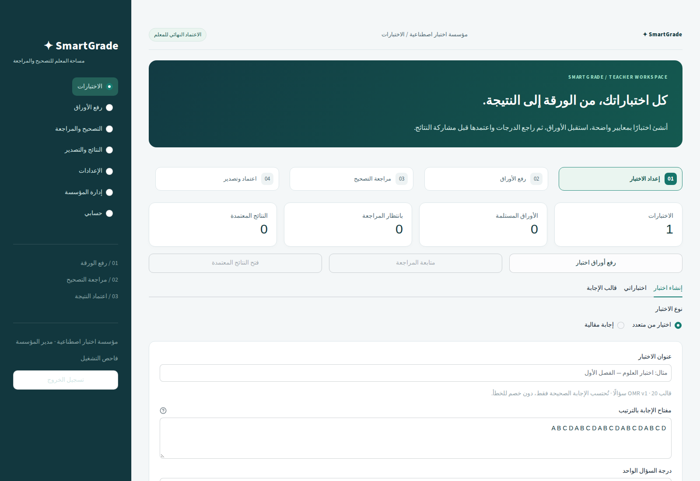

# واجهات SmartGrade للعمل المؤسسي

تُشغّل هذه الواجهات نفس الخادم وقاعدة البيانات ومحرك التصحيح. لا تغيّر الدرجات القديمة، ولا تفعّل مزود الذكاء الاصطناعي تلقائيًا.

## خطوات المعلم

1. من «الاختبارات»، أنشئ اختبارًا. في المقال، أضف أي عدد من الأسئلة وحدد الإجابة النموذجية ودرجة كل سؤال ومعاييره. يظهر مجموع المعايير بجوار درجة السؤال.
2. افتح «اختباراتي» وابحث عن العنوان أو نوع الاختبار. أزرار كل اختبار تفتح الرفع أو المراجعة أو النتائج الخاصة به.
3. في الرفع، افحص المعاينة والأبعاد والوضوح، وأدخل رمز الطالب. إذا كان الملف غير صالح تظهر رسالة قبل حفظه. بعد الحفظ، افتح الورقة مباشرة بزر «مراجعة الورقة المرفوعة».
4. في المراجعة، ابحث برمز الطالب وصفِّ الحالة. التنقل بين الأوراق لا يعتمد درجات. احفظ النص وتوزيع الإجابات ثم راجع درجة كل معيار وأكّد الاعتماد.
5. في النتائج، نزّل Excel أو CSV أو PDF. تشمل الملفات النتائج المعتمدة فقط.

## التصميم والتنقل

- هوية عربية موحدة بألوان خضراء داكنة، بطاقات واضحة، مراحل العمل، وحالات فارغة تشرح الخطوة التالية.
- دعم اتجاه RTL، وتخطيط متجاوب، وتنقل مرئي على الهاتف، ومؤشر تركيز بلوحة المفاتيح.
- عرض هوية المؤسسة، وتوضيح الفرق بين اقتراح النموذج واعتماد المعلم.
- لا تُحمَّل الخطوط أو الصور من خدمات تصميم خارجية.
- الصور الخاصة في وضع المؤسسات تستخدم آلية العرض الخاصة القائمة في المشروع.
- البحث والتصفية في الويب وAndroid يشملان الصفحة المحملة فقط. استخدم ترقيم الصفحات للوصول إلى سجلات أخرى.
- عدادات المؤسسة والاختبار من الخادم؛ عدد نتائج البحث يخص الصفحة الحالية.

## Android

**التشغيل الافتراضي أصبح محليًا:** لا يحتاج رابطًا أو حساب مؤسسة، وMCQ وOCR والتقارير تعمل على الهاتف. تقييم المقالات في هذا الوضع يدوي. راجع [دليل النسخة المحلية وحفظ البيانات](ANDROID_OFFLINE_AR.md). وضع المؤسسة السابق يحتاج اختيار APP_MODE=remote أثناء البناء.

يشمل التطبيق نفس الهوية البصرية، وبطاقات تعريف الاختبارات، وبحثًا في الاختبارات والأوراق، وتصفية حالة الورقة، وحالات عربية بدل رموز الخادم. تُعطّل أزرار التصدير عندما لا توجد نتائج معتمدة. تبقى صلاحيات الحساب وآلية حفظ المسودات والاعتماد من الخادم.

## التحقق

تُشغّل اختبارات التنقل والبحث والتصفية والحفاظ على الدرجات، إضافة إلى اختبارات المشروع. يشغّل سيناريو المتصفح الخادم والواجهة والعامل فعليًا ببيانات اصطناعية، ويختبر الرفع ومعاينة الصورة وOCR والحفظ والاعتماد والتصدير وإعادة التشغيل والتخطيط بعرض 390 بكسل.

تُحفظ صور ونتائج التشغيل تحت experiments/live_runtime/evidence. راجع source_commit في التقرير لمعرفة المصدر المختبر. لا تستنتج دقة التصحيح المقالي من هذه الاختبارات: الدرجة المرجعية 17/30 مدخلة آليًا باسم معلم الاختبار، ولا تُجرى طلبات نموذج مدفوعة في تحقق الواجهات.

هذه التحسينات تجعل العمل اليومي أوضح، لكنها ليست اعتمادًا تجاريًا لدقة النموذج أو قراءة خط اليد. الإتاحة الدائمة تحتاج استضافة الخدمة وإعدادها وفق دليل التشغيل؛ Colab جلسة مؤقتة.

## معاينة فعلية ونتائج التشغيل

هذه صور من التطبيق العامل ببيانات اصطناعية، وليست تصميمًا منفصلًا:

[واجهة الهاتف](../experiments/live_runtime/evidence/07-workspace-mobile.png) · [معاينة رفع الصورة](../experiments/live_runtime/evidence/01-upload-ready.png) · [نتائج معتمدة](../experiments/live_runtime/evidence/05-results.png)

اجتاز سيناريو المتصفح **25 فحصًا** تشمل الرفع وOCR وخمسة أسئلة واعتماد الدرجة المرجعية وتصدير الملفات والتنقل على الهاتف وإعادة التشغيل. لم يُستدعَ مزود LLM. [التقرير الآلي](../experiments/live_runtime/evidence/runtime-report.json) يسجل المصدر المختبر والنتائج الفعلية.

[تشغيل المتصفح](https://github.com/alkhwarzmy/SmartGrade-AI/actions/runs/45062246125) · [تحقق Python وAndroid والحاوية](https://github.com/alkhwarzmy/SmartGrade-AI/actions/runs/45062246154)

تجد APK للاختبار الداخلي ضمن مرفقات تحقق الإصدار باسم Android-test-apk. هذه حزمة debug للاختبار؛ النشر في متجر Google Play يتطلب بناء إصدار موقّع بمفتاح مالك التطبيق.
