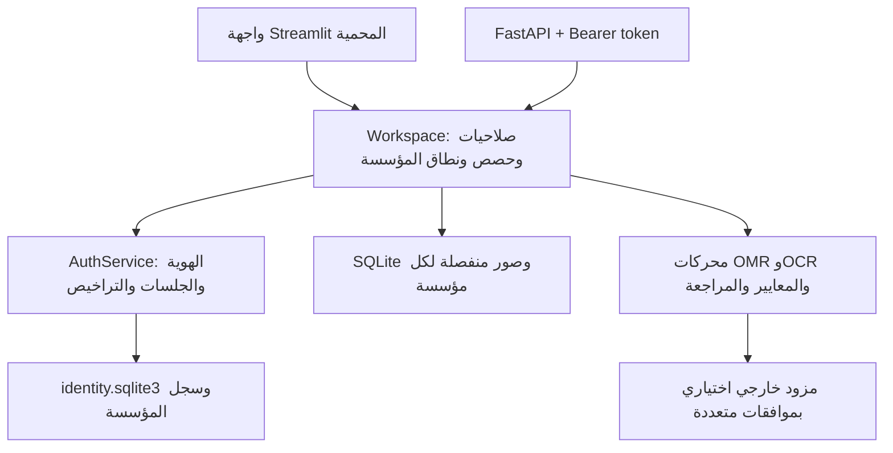

# بنية إصدار المؤسسات 1.0.0-rc1

## الهوية والنطاق

`SMARTGRADE_MODE=commercial` هو الافتراضي. لا يوجد حساب أو كلمة مرور افتراضية، ولا endpoint عام لإنشاء مؤسسة. تهيئة المؤسسة ومديرها تتم من CLI لمشغل الخادم. `demo` وضع صريح منفصل للتجربة في Colab واختبارات MVP، ولا يوفر مصادقة.

`AuthService` يحفظ المؤسسات والمستخدمين والجلسات وحدود الدخول والسجل في قاعدة تحكم مركزية. كلمات المرور مشتقة بـPBKDF2-HMAC-SHA256 مع 600,000 تكرار وsalt عشوائي؛ الرموز عشوائية 256 بت وتُحفظ بصماتها فقط. الدور وعضوية المؤسسة يُقرآن من الخادم عند كل إجراء. الجلسات تنتهي بعد 8 ساعات أو 30 دقيقة خمول؛ تغيير كلمة المرور أو الدور أو التعطيل يلغي الجلسات. الهوية المخزنة لكل اعتماد هي معرف المستخدم، ولا يستطيع المراجع تزويرها بحقل اسم في الطلب.

التنفيذ لا يعتمد على query parameter أو ترويسة مؤسسة. مسار البيانات يُشتق من UUID المؤسسة المسجلة في الجلسة، داخل `organizations/<uuid>/`. تُرفض معرفات الاختبارات والتسليمات الأجنبية حتى إن عرفها العميل. دور المشاهد يستقبل إسقاطًا للنتائج المعتمدة دون الصور والنص الخام والسجل؛ API لا يعيد له مواصفات مفتاح الإجابة.

## التخزين والتزامن

لكل مؤسسة قاعدة `smartgrade.sqlite3` وصور بأسماء عشوائية. `Workspace` هو بوابة الشبكة؛ `Store` محرك داخلي موثوق لا يُعرض مباشرةً للعميل. تحفظ SQLite المفاتيح الأجنبية وقيود الحالات، وتطبق الخدمات/Pydantic حدود المعايير ومجموع الدرجات والأدلة. تُكشف مراجعة قديمة برقم الإصدار ويعيد API حالة 409 بدل استبدال تعديل أحدث.

قفل ملفات Linux لكل مؤسسة ينسق الكتابات والحصص بين عمليتي web وAPI على **مضيف واحد وقرص محلي**. لا يدعم هذا التصميم توزيع نسخ التطبيق على عدة مضيفين أو NFS أو Drive أو مشاركة SQLite بين عقد مستقلة. فحص سعة الأوراق/الاختبارات ذري تحت القفل. فحص التخزين يسبق حفظ الصور الجديدة ويحتسب مساحة احتياطية للبيانات؛ لا يمنع نمو سجلات المراجعة مستقبلًا من تجاوز سعة القرص، ولذلك تتطلب العمليات مراقبة واحتفاظًا.

مخطط الهوية ذو نسخة `PRAGMA user_version=1` وترحيل تهيئة إضافي دون حذف بيانات. قواعد MVP للمؤسسات تستخدم مخطط الاختبارات الأول؛ لا يُدّعى وجود سلسلة ترحيلات Postgres/Alembic. مصدر MVP القديم يبقى مستقلًا حتى يستورده المشغل إلى مساحة مؤسسة فارغة بعد نسخه احتياطيًا.

## سلامة المراجعة والسجل

مقترح المقالات منفصل عن الدرجة المعتمدة. لا اعتماد دون المراجع، ويُلغي تغيير النص الاعتماد والمقترح. سجل الدرجة قبل/بعد التغيير في المعاملة نفسها بقاعدة المؤسسة. سجل الهوية/الإجراءات المركزي إضافي، متسلسل SHA-256، وتمنع triggers تعديله وحذفه عبر DML العادي. لا يحفظ نص الإجابات أو كلمات المرور أو رموز الجلسة.

هذا السجل ليس سجلًا قانونيًا غير قابل للعبث: مدير النظام الذي يملك الملفات والمخطط يمكنه إعادة كتابتها. كما أن قاعدة المؤسسة والسجل المركزي ليسا معاملة موزعة واحدة؛ تعطل العملية بين حفظ الدرجة وإضافة الحدث المركزي قد يترك فجوة، بينما يبقى سجل الدرجة داخل معاملتها. إن تطلب العميل ضمانًا أقوى يلزم outbox وأرشيف خارجي محمي وتدقيق مستقل.

## واجهات النقل

FastAPI يفرض Bearer auth، وحد حجم فعلي حتى مع جسم دون Content-Length، وإجابات أخطاء لا تعيد كلمات المرور، و`Cache-Control: no-store`. واجهة Streamlit تحفظ الجلسة على الخادم وتزيل حالتها عند الخروج. لا تُسجل صور وتقارير الطلاب في MediaFileManager العام في الوضع التجاري؛ تُضمّن داخل العرض/روابط تنزيل data URI. الصور تُصغر للعرض فقط، وتبقى الأصلية للتحليل والمراجعة عبر API الموثق. حد التنزيل داخل الواجهة 10 MB؛ API الموثق للتقارير الأكبر، وPDF يقتصر على 2000 نتيجة.

Caddy هو حد TLS الخارجي، مع منافذ web/API داخل الشبكة فقط. التطبيق لا يضع أسرارًا في المتصفح أو Git أو النسخ المحمولة. التقرير الذي وصل إلى جهاز مستخدم مخوّل لا يمكن سحبه من جهازه لاحقًا؛ سياسة تنزيل البيانات مسؤولية المؤسسة.

## الذكاء الاصطناعي

تحتاج الخدمة الخارجية سماح المشغل وسماح مدير المؤسسة وموافقة المراجع لكل طلب. يُتحقق من سياسة المؤسسة في الخادم قبل الاتصال، وليس بتعطيل الزر وحده. تُرفض المقترحات الخاطئة ويعود التسليم للمراجعة. صحة الاقتباس وJSON لا تثبت صحة التقييم؛ جودة الخط اليدوي واتفاق الدرجات على بيانات حقيقية غير مقيسين بعد.
