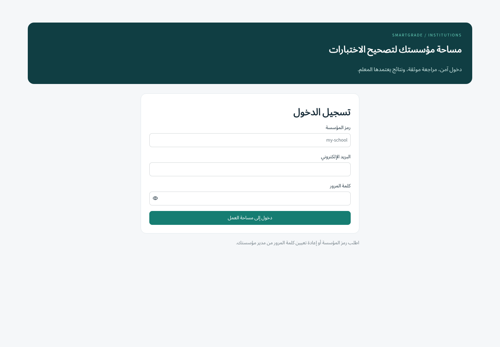
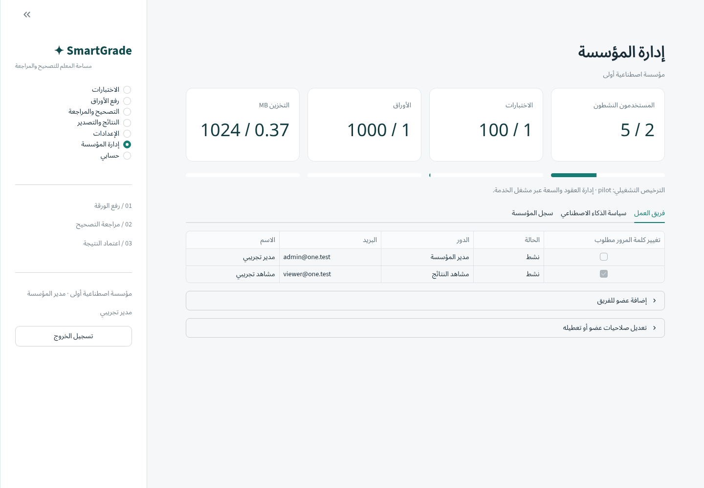

# SmartGrade AI للمؤسسات — 1.0.0-rc1

**الحالة: مرشح تجربة تجارية مُدارة على مضيف واحد.** الإصدار يضيف تشغيلًا مؤسسيًا إلى MVP؛ لا يختزل الجاهزية التجارية في تحسين الواجهة ولا يدّعي اعتماد النموذج أو الأمن أو الالتزام القانوني قبل تحقق العميل.

## النطاق المسلم

- دخول فعلي دون حسابات افتراضية، وتقييد للمحاولات، وكلمات مرور مشتقة، وجلسات منتهية وقابلة للإلغاء، وتغيير إلزامي للمؤقتة.
- مؤسسات ببيانات وصور منفصلة، وصلاحيات مدير ومعلم ومشاهد، وتحقق في الخادم لكل عملية؛ لا اختيار المؤسسة من العميل.
- إدارة أعضاء وإلغاء جلساتهم وتعطيلهم وحماية حساب المدير، وسياسة AI للمؤسسة قبل أي إرسال.
- حدود تشغيل حسب عقد pilot/school/campus؛ لا أسعار أو فاتورة أو تحصيل مفترض.
- MCQ ومقالات ومراجعة واعتماد وتاريخ درجة، وAPI محمي ومحدد الحجم وأخطاء لا تعيد الأسرار.
- Excel/CSV للمعتمد وPDF عربي ملخص بخط مضمن، وصور وتنزيلات خاصة داخل عرض الجلسة التجارية.
- سجل مؤسسة متسلسل، ونسخ/استعادة/استيراد قديم/إلغاء جلسات وأداة احتفاظ dry-run، ووثائق تشغيل واستجابة وترقية.
- Docker غير جذري بجذر قراءة وبيانات منفصلة وCompose/Caddy لإعداد TLS، ودفتر Colab demo صريح يُعاد بناؤه من المصدر.

## التحقق المنفذ

| الفحص | النطاق الحقيقي |
|---|---|
| 71 اختبار Python | المجموعة السابقة44 + الهوية والعزل11 + API9 + الواجهة التجارية2 + العمليات5 |
| العزل | رفض معرفات مؤسسة أخرى في القراءة والتعديل والحذف والتقارير، ومنع المشاهد من الصور والمسودات والتعديل |
| الهوية | اشتقاق مستقل، token hash، الخمول والانتهاء والإلغاء والتعطيل وتغيير الدور/كلمة المرور، وحدود المحاولات |
| الحصص | منع اختبارات متزامنة زائدة تحت قفل عبر العمليات، ورفض ورقة قبل حفظها عند نفاد مساحة الرفع |
| API | دورة MCQ20/20 اصطناعية، تصدير، no-store، رفض جسم كبير، أخطاء مخفية القيم، stale revision409، وسياسة AI قبل الاتصال |
| واجهة Chromium | دخول خاطئ وصحيح، اعتماد بهوية ثابتة، صورةinline، تنزيل Excel/PDF، تغيير مؤقتة، مشاهد محدود، خروج وعزل مؤسسة ثانية وجوال |
| PDF | فُتح الناتج ورُسمت صفحته وفُحصت العربية بصريًا؛ ليس توقيعًا رقميًا أو إثبات تقييم تربوي |
| الحاوية | صورة بمتطلبات runtime فقط؛ اختبار داخل الصورة لـUID10001 وجذر قراءة وغياب CA البناء وAPI وPDF وسجل وواجهة حسابات، ثم جاهزية ودخول وقراءة اختبارات عبر HTTP فعلي داخل الحاوية |
| إعداد Caddy | Compose config وCaddy adapt نجحا على نطاق .test دون نشر عام أو طلب شهادة عميل |
| Colab | يفحص المدقق خلايا Python والبصمة والمصدر، ثم يفكها ويشغل الاختبارات محليًا؛ لم تُفتح جلسة Google بحساب المستخدم |

الأدلة القابلة للقراءة في `docs/evidence/commercial-*.json` و`commercial-pytest.txt`، وبرامج إعادة التحقق داخل `scripts/`. بيانات الاختبار ومؤسساته وكلمات مروره اصطناعية، وتُنظَّف الحاويات ومجلداتها بعد الاختبار. توجد ملاحظة deprecation من مكتبة اختبار Starlette/httpx؛ لا فشل اختبار بسببها.

### لقطات من رحلة معزولة

## النموذج التجاري الذي يدعمه الكود

تشغيل مُدار/تثبيت خاص مع تجهيز مؤسسة من المشغل، وحساب مدير وفريق، وخطة سعة وسريان عقد يدوي. الأدوات تمنع الإضافة الزائدة والوصول عند تعطيل المؤسسة أو انتهاء السريان. يضع صاحب المشروع السعر والعقد والفاتورة وقناة الدعم، ويقرر بوابة الدفع لاحقًا حسب السوق والحسابات المتاحة؛ لا توجد أزرار شراء وهمية أو عمليات مالية نُفذت.

## شروط الانتقال من المرشح إلى إطلاق عملاء

1. جهّز بيئة staging ثم نطاقًا وTLS ونسخًا ومراقبة فعلية، واختبر الاستعادة والحمل بالحجم والتزامن المتوقعين. حصص المنتج ليست قياس أداء.
2. اختبر خط اليد وOMR على صور حقيقية مصرح بها، وقارن اقتراحات المقالات بدرجات معلمين مستقلين وفق بروتوكول موثق؛ أبقِ المراجعة البشرية.
3. نفّذ مراجعة أمنية مستقلة مناسبة للسياق، وقيّم الحاجة إلى SSO/MFA وWAF والعزل الأقوى والتدقيق الخارجي؛ لا شهادة أو نتيجة اختراق مفترضة.
4. اعتمد معالجة البيانات والاحتفاظ والنسخ والتراخيص ومزودي AI والإنفاق مع العميل، ثم التسعير والعقد والدعم والتزامات الخدمة التي يمكنك الوفاء بها.

النسخة لا تشمل معالجة دفعات خلفية أو تخطيطًا حرًا أو تدريب HTR أو فوترة محصلة أو بنية موزعة أو ضمان امتثال. ملف operations.md يشرح التشغيل الفعلي، وarchitecture.md يوضح حدود السجل والمعاملات، وlimitations.md يسرد الحدود الحالية. لم يُنشر تطبيق عام أو تُرفع بيانات طلاب أو تُنفذ طلبات AI مدفوعة خلال هذه الجلسة.
